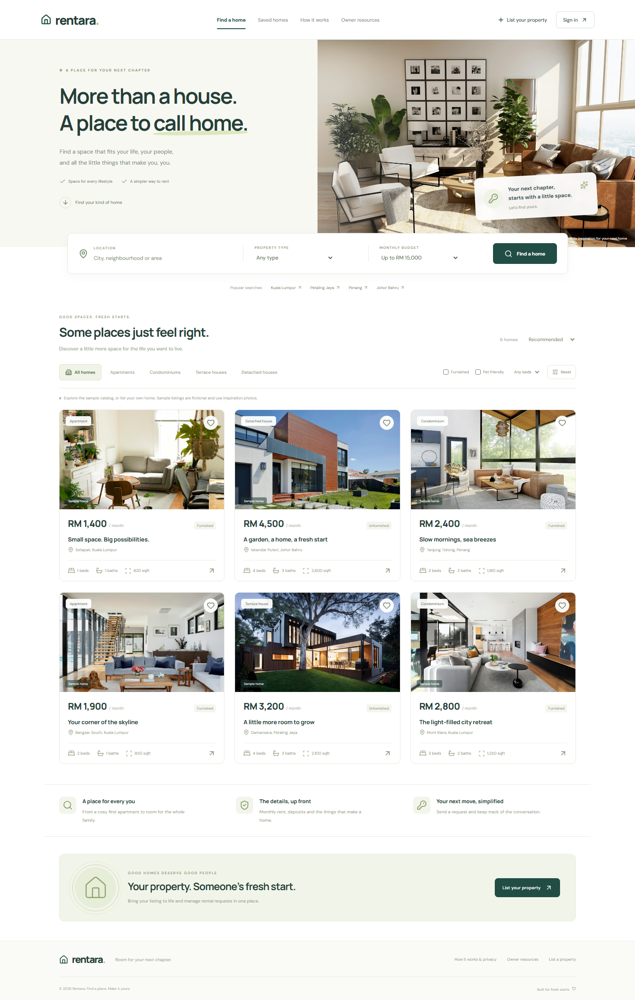

# Rentara

**More than a house. A place to call home.**

A responsive house-rental web app built from the `innovation_license1` Next.js blueprint, with the requested Rebana License sandbox integration.



## What works

- Search by city/neighbourhood, monthly budget and property type.
- Filter by bedrooms, furnished homes and pet policies; sort by price or floor area.
- View property details, availability, neighbourhood maps and move-in cost estimates.
- Save favourite homes in browser storage.
- Create an account, sign in and sign out with server-managed sessions.
- Publish a property, pause it, or republish it from the owner dashboard.
- Submit a rental request with a move-in date, lease length and introduction.
- Owners can review, accept or decline requests. Renters can track and cancel requests.
- Persistent SQLite storage for users, properties, sessions and rental requests.
- Browse Rebana council zones, licence types and business activities with complete pagination.
- Desktop/mobile layouts, keyboard-accessible dialogs, reduced-motion support and clear loading/error states.

The initial six homes are **fictional sample listings**, visibly labelled in cards, details and request forms. They are not pulled from Rebana and have no real landlord. Owners can publish their own listings using the form. Photos are labelled illustrations; photo uploads are not part of this version.

A rental request, including an accepted one, is **not** a reservation, payment or signed tenancy agreement. The app does not collect money or verify ownership.

## Run locally

Requires **Node.js 24+** (uses built-in `node:sqlite`) and npm.

```sh
npm ci
cp .env.example .env.local
npm run dev
```

Open **http://localhost:3120**. On Windows PowerShell use `npm.cmd` if execution policy blocks `npm.ps1`.

The rental app works without Rebana credentials. To enable owner reference resources, fill in the sandbox credential fields in `.env.local`. The credentials are only used on the server and must never have a `NEXT_PUBLIC_` prefix.

The database is created automatically at `data/rentara.db`, with six sample homes. There are **no preset accounts or default passwords**; use Create account. Any account can rent a home and list its own properties.

```sh
npm run typecheck
npm test
npx playwright install chromium
npm run test:e2e
npm run build
npm start
```

Browser tests use a separate SQLite database at `data/e2e.db` and a dedicated local server on port 3122. Tests exercise real authentication and persistence, renter/owner permissions, state transitions, filters, saving, mobile navigation and the Rebana UI (fixture-based). The main database is not used by the tests.

## Blueprint and architecture

The supplied blueprint's Next.js App Router, TypeScript, Redux Toolkit, server-only OAuth broker, shared API models, HTTP client and paginated services are retained. The rental feature follows its **model → service → action/reducer/selector/effect/state → page** structure.

```text
src/
  app/
    api/auth/                  Registration, sign-in, sign-out and session reads
    api/rentals/[resource]/    Catalog, owner dashboard, listings and requests
    api/sandbox/[...path]/     Allowlisted Rebana read proxy
  core/
    auth/                     Blueprint OAuth broker + app session handling
    db/                       SQLite schema and rental operations
    http/                     Blueprint transport + request validation
  shared/
    models/                   Blueprint API contracts and rental models
    services/                 API clients, filter logic and price estimates
    data/                     Clearly labelled sample catalog
    components/               Home cards and accessible modal
  modules/
    homes/                    Discovery, listing/details UI and Redux feature
    account/                  Account dialog
    requests/                 Rental request form
    dashboard/                Renter/owner workspace
    references/               Rebana reference browser
  store/                      Per-instance middleware and typed hooks
```

## What the requested API provides

Specification: https://rebana.canang.com.my/rebana-license/v3/api-docs/sandbox

Rebana exposes `ping`, `zones`, `license-types`, `business-activities` and `statistics`. It does **not** provide housing listings, prices, availability, booking, ownership verification or payment APIs. Rentara therefore owns its rental catalog and workflow, and uses Rebana for the real council-reference section.

The server proxy allows only those five documented paths. It validates pagination, pages through the complete reference catalogs, caches slow-changing data, deduplicates requests, refreshes OAuth once after a 401, and surfaces rate limits with a retry interval. It removes the sandbox principal and token metadata from public ping responses. Null risk categories are displayed as unclassified.

Reference cache TTL is five minutes; statistics use 30 seconds. The proxy caps uncached calls at 90/minute per process. It is a public read interface, so a high-traffic or multi-instance deployment needs a shared rate limiter or restricted resource access. A copy of the public specification is in `docs/rebana-openapi.json`.

## Accounts, permissions and privacy

- Passwords are salted with cryptographically random bytes and hashed using scrypt.
- Random session tokens are stored only as SHA-256 hashes in SQLite; cookies are HttpOnly, SameSite=Lax, and Secure in production, with a seven-day expiry.
- Write requests must originate from the same application origin. Set `APP_ORIGIN` to your public HTTPS origin behind a reverse proxy.
- Database operations use bound SQL parameters; only property owners can change their listings or answer their incoming requests.
- Only a renter can cancel their own request. Accepted/declined responses must originate from the pending state; duplicate active requests are blocked.
- Sign-in/registration attempts have an in-process, per-email limit. Public deployments should add a shared edge/IP rate limiter.
- Names, emails, listings and requests are kept in the server database. Owners receive the renter's name, email and submitted request details for their own listings.
- Accepting a request shares the owner's account name and email with that renter so they can arrange the next steps directly. Pending requests do not expose owner contact details.
- Saved homes remain in localStorage on the current browser/device.
- External map links use Google Maps; fonts load from Google Fonts. Inspiration photographs are served locally.

Email verification, password recovery, account deletion UI, email delivery, payments, uploaded photos, signed leases, identity checks and property verification are **not implemented**. Do not advertise these as available. Account help and deletion currently require the installation operator. The UI explains sample listings, request semantics and data visibility.

## Deployment

This is a server-backed app. GitHub publishes the source code; **GitHub Pages cannot execute these API routes**.

Run it on a Node.js 24+ server/container with a persistent writable disk:

```sh
npm ci
npm run build
# Set APP_ORIGIN=https://your-domain.example
# Set RENTARA_DB_PATH=/persistent-volume/rentara.db
# Set the four private SANDBOX_* credentials if using Rebana references.
npm start
```

Terminate HTTPS through your host/reverse proxy and set `APP_ORIGIN` to the exact browser-facing origin (without a trailing slash). Use a persistent volume and database backups. Do not use an ephemeral serverless filesystem for the SQLite database. For multiple instances, replace SQLite/process-local rate limits with an appropriate shared database and limiter.

Environment files, databases (including test accounts), node_modules and build outputs are excluded from Git and server output tracing. The repository contains setup examples, not live credentials.

## Credits

- Blueprint: the supplied `innovation_license1`.
- Council API: Rebana License sandbox.
- Photography: Unsplash, with source URLs in [docs/ASSETS.md](docs/ASSETS.md).
- Icons: Lucide. Fonts: DM Sans and Manrope, with system fallbacks.

No blanket licence is asserted over the supplied blueprint. Confirm rights and third-party licences before redistributing or relicensing.
